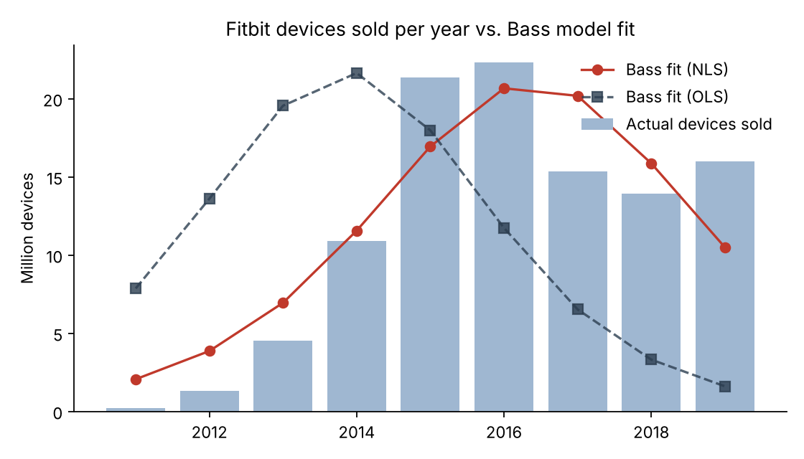
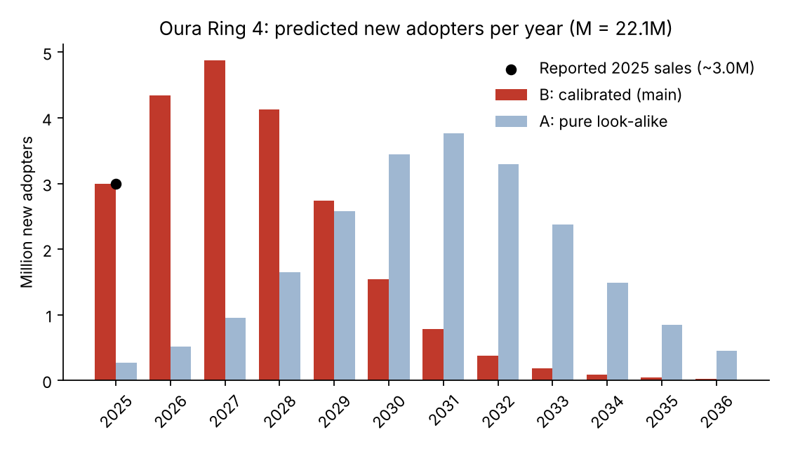
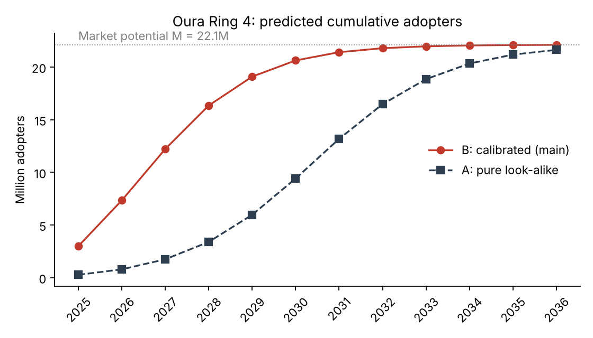

# 1. The innovation I chose

For this homework I picked the **Oura Ring 4** from TIME's Best Inventions of 2025 list.

Link: <https://time.com/collections/best-inventions-2025/7318554/oura-ring-4/>

The Oura Ring 4 is a smart ring made by a Finnish company. You wear it on your finger and it tracks your sleep, heart rate, blood oxygen, skin temperature and movement, then shows everything in an app. It came out in October 2024 and costs \$349, and you also need a \$5.99 monthly membership [9]. TIME liked it because it has 18 signal pathways instead of 8 like the older ring, so the readings are more accurate. It also has a feature called Symptom Radar that tries to notice early signs of a cold or flu [1][9].

# 2. The look-alike innovation from the past

As a look-alike I chose **Fitbit fitness trackers**.

I think Fitbit is the closest older product to the Oura Ring. Both are small health trackers that you wear all day and even while sleeping. Both count steps, track sleep and heart rate, and send the data to an app that gives you scores and tips. The technology inside is also pretty similar: small sensors, Bluetooth syncing to the phone and a battery that lasts several days. Basically the Oura Ring takes the Fitbit idea and moves it from the wrist to the finger, and makes it look more like jewelry.

Their market impact is similar too. Fitbit was the first big brand of connected fitness trackers and led the market for years, selling in 63 countries [3]. Oura did the same thing for smart rings and now has around 74% of all smart ring shipments in the world [5]. The main difference is the price. Fitbits cost \$60–\$250 [3], while Oura costs \$349 or more plus a subscription. Because of this I expect the Oura market to be smaller (more on this in Section 7).

# 3. Historical data

I wanted to use Statista, but it only works on the AUA network, so I took the numbers directly from Fitbit's reports to the U.S. SEC. These are official company filings, so I think they are even more reliable.

| Year | Fitbit devices sold (million) | Source |
|---|---|---|
| 2011 | 0.2 | Fitbit S-1 (2015) [4] |
| 2012 | 1.3 | Fitbit S-1 (2015) [4] |
| 2013 | 4.5 | Fitbit S-1 (2015) [4] |
| 2014 | 10.9 | Fitbit 10-K FY2016 [3] |
| 2015 | 21.355 | Fitbit 10-K FY2019 [2] |
| 2016 | 22.295 | Fitbit 10-K FY2019 [2] |
| 2017 | 15.343 | Fitbit 10-K FY2019 [2] |
| 2018 | 13.939 | Fitbit 10-K FY2019 [2] |
| 2019 | 15.988 | Fitbit 10-K FY2019 [2] |

The data is saved in `data/fitbit_devices_sold.csv`. The data ends in 2019 because Google bought Fitbit in 2021 and Fitbit stopped reporting its own numbers.

One problem with this data is that "devices sold" also counts people who bought a second Fitbit, so it is not exactly the number of new adopters. Still, it was the best yearly data I could find, and it has the typical Bass shape: slow start, fast growth, peak in 2016 and then a drop.

# 4. Estimating p, q and M for Fitbit

I used the Bass model from class [11]:
$$a(t) = M \cdot f(t), \qquad f(t) = \frac{(p+q)^2}{p}\cdot\frac{e^{-(p+q)t}}{\left[1+\frac{q}{p}e^{-(p+q)t}\right]^2}$$

Here *p* is the coefficient of innovation, *q* is the coefficient of imitation and *M* is the market potential. I set t = 1 for 2011.

I tried the two estimation methods we saw in the lecture. The first one is non-linear least squares (NLS), which is the same as `nls()` in R; I did it in Python with `curve_fit`. The second one is Bass's linear regression (OLS): $a(t) = \beta_0 + \beta_1 A(t-1) + \beta_2 A(t-1)^2$, where $\beta_0 = pM$, $\beta_1 = q-p$ and $\beta_2 = -q/M$.

| Method | p | q | M (million) | Peak time t\* | R² |
|---|---|---|---|---|---|
| NLS | 0.0087 | 0.670 | 122.4 | 6.4 (2016–2017) | 0.82 |
| OLS | 0.038 | 0.730 | 107.5 | 3.9 (2013–2014) | −1.00 |

I went with the NLS results. They fit the data much better (R² = 0.82), and the peak time $t^* = \ln(q/p)/(p+q) = 6.4$ falls right where the real peak was, in 2016. OLS puts the peak around 2014, which didn't happen. From what I read, OLS often does badly when there are only a few data points, and NLS usually gives better estimates [16].

{width=78%}

I think the numbers make sense. p = 0.0087 is very small, which means almost nobody bought a fitness tracker just on their own when it was new. q = 0.67 is big, so most of the growth came from people copying their friends, family and coworkers. This fits Fitbit well, because it had step challenges with friends and companies gave Fitbits to their employees in wellness programs [3]. For comparison, a big review of Bass model studies found an average of p ≈ 0.03 and q ≈ 0.38 [12], so fitness trackers spread through imitation much faster than most products. Finally, M = 122 million is close to the 106 million devices Fitbit actually sold by 2019, which makes sense since its sales were already going down.

# 5. Predicting the diffusion of Oura Ring 4

For a new product, the lecture says to find a look-alike, use its *p* and *q*, and estimate *M* yourself. I set t = 1 as 2025, because that was the first full year Ring 4 was on sale (it started shipping on 15 October 2024 [9]).

I made two scenarios. In **Scenario A** I just used both p = 0.0087 and q = 0.670 from Fitbit. In **Scenario B**, which is my main forecast, I kept q = 0.670 but chose *p* so that the model matches what Oura really sold in 2025. Oura sold almost 3 million of its 5.5 million total rings in 2025 [7]. I checked this another way too: around 4 million smart rings were shipped worldwide in 2025 [6], and Oura has 74% of the market [5], which also gives about 3 million. Solving $M \cdot F(1) = 3.0$ gave me p = 0.104.

I trust Scenario B more because Scenario A predicts only 0.27 million adopters in 2025, while the real number was around 3 million. I think the reason is that Fitbit in 2011 was a brand-new product nobody knew, but Ring 4 is not Oura's first ring. Oura has been selling rings since 2015, had already sold 2.5 million by June 2024 [7] and gets a lot of media attention. So many people bought Ring 4 because they already knew the brand or saw ads, not only because of friends, and that means a much higher *p*. I kept *q* from Fitbit because the word-of-mouth side of health wearables should be similar.

Another thing that supports Scenario B: Oura expects around \$1.5 billion revenue in 2026, three times its 2024 revenue [5]. My model gives 4.3 million adopters in 2026, and 4.3 million × \$349 is about \$1.5 billion from rings alone. So the forecast seems realistic.

# 6. Scope: global

I decided to do the analysis worldwide. Oura sells in more than 150 countries [6] and a big part of its growth came from going international [7]. The Fitbit data is also worldwide: it sold in 63 countries and about 25% of its revenue came from outside the U.S. in 2014 [3][4]. Also, Oura doesn't publish sales by country, so if I did only the U.S. or only Armenia I would have no real numbers to compare with.

Still, "global" doesn't mean all 8 billion people. A \$349 ring with a monthly fee is mostly bought in richer countries, so I based *M* on the population of high-income countries.

# 7. Market potential (Fermi estimate) and adopters by period

To estimate *M* I used Fermi logic:

| Step | Value | Source |
|---|---|---|
| Population of high-income countries (2025) | 1.42 billion | World Bank via FRED [13] |
| × share of adults who wear a smartwatch or fitness tracker | 21% → 299 million | Pew Research [14] |
| × share of these who would buy a smart ring | 10% → 29.9 million | my assumption |
| × Oura's share of the smart ring market | 74% → M ≈ 22.1 million | Omdia [5] |

The 10% is my own guess, so I also tried 5% and 15% (table below). I think 10% is reasonable: smart rings are still small compared to smartwatches [7], but in the U.S. they already make 75% of fitness tracker revenue [10], so quite a lot of people are switching to rings. Also, around 535 million wearables were shipped worldwide in 2024 [15], so 22 million Oura owners would still be a small niche.

Predicted new adopters per year (million people):

| Year | t | Scenario B: new | Scenario B: cumulative | Scenario A: new | Scenario A: cumulative |
|---|---|---|---|---|---|
| 2025 | 1 | 3.00 | 3.00 | 0.27 | 0.27 |
| 2026 | 2 | 4.35 | 7.35 | 0.52 | 0.79 |
| 2027 | 3 | **4.88** | 12.22 | 0.95 | 1.75 |
| 2028 | 4 | 4.13 | 16.35 | 1.65 | 3.40 |
| 2029 | 5 | 2.74 | 19.09 | 2.58 | 5.97 |
| 2030 | 6 | 1.54 | 20.63 | 3.45 | 9.42 |
| 2031 | 7 | 0.78 | 21.41 | **3.76** | 13.18 |
| 2032 | 8 | 0.38 | 21.79 | 3.30 | 16.48 |
| 2033 | 9 | 0.18 | 21.97 | 2.38 | 18.85 |
| 2034 | 10 | 0.08 | 22.05 | 1.48 | 20.34 |
| 2035 | 11 | 0.04 | 22.09 | 0.84 | 21.18 |
| 2036 | 12 | 0.02 | 22.11 | 0.46 | 21.64 |

I calculated new adopters for each year as $M \cdot [F(t) - F(t-1)]$, so the yearly numbers add up to the cumulative total. The full table is in `data/oura_forecast.csv`.

{width=78%}

{width=78%}

In my main scenario (B), Oura Ring 4 adoption grows fast and peaks in 2027 with about 4.9 million new adopters. By 2030 around 93% of the market potential, about 20.6 million people, will have adopted. After that, most sales would probably be people upgrading to newer models like the Ring 5, which came out in June 2026 [8], and the basic Bass model doesn't cover that.

Since the 10% was a guess, here is what happens if I change it:

| Ring share | M (million) | p | Peak year | New adopters 2026 | Cumulative by 2030 |
|---|---|---|---|---|---|
| 5% | 11.1 | 0.230 | 2026 | 3.2 | 10.9 |
| 10% | 22.1 | 0.104 | 2027 | 4.3 | 20.6 |
| 15% | 33.2 | 0.067 | 2028 | 4.8 | 29.3 |

So changing *M* mainly changes how big the market gets and moves the peak by about a year. The overall shape stays the same, with fast growth now and a peak somewhere between 2026 and 2028.

# 8. Conclusion and limitations

Using Fitbit as the look-alike, I got p = 0.0087, q = 0.67 and M = 122 million. For Oura Ring 4 I used Fitbit's q, a global market potential of about 22 million people and a p based on 2025 sales. My forecast is that adoption peaks in 2027 with around 4.9 million new adopters, and about 21 million people will have adopted by 2030.

This analysis has some limitations. Fitbit's numbers include people buying a second device, not only first-time buyers. The 10% share of people who would buy a ring is my own guess, which is why I added the sensitivity table. Pew's 21% is only for U.S. adults, and I assumed other rich countries are similar. Finally, the basic Bass model doesn't consider price changes, competitors like Samsung Galaxy Ring, Ultrahuman and RingConn, or new models like the Ring 5.

# References

[1] TIME. (2025, October 9). *Oura Ring 4: The Best Inventions of 2025*. <https://time.com/collections/best-inventions-2025/7318554/oura-ring-4/>

[2] Fitbit, Inc. (2020). *Form 10-K for fiscal year 2019*. U.S. SEC. <https://www.sec.gov/Archives/edgar/data/1447599/000144759920000016/fit-20191231.htm>

[3] Fitbit, Inc. (2016, 2017). *Form 10-K for fiscal years 2015 and 2016*. U.S. SEC. <https://www.sec.gov/Archives/edgar/data/0001447599/000144759916000018/fitbit1231201510k.htm>; <https://www.sec.gov/Archives/edgar/data/0001447599/000144759917000010/fitbit1231201610k.htm>

[4] MobiHealthNews. (2015). *Fitbit files for IPO, sold nearly 11 million fitness devices in 2014* (summary of Fitbit's Form S-1). <https://www.mobihealthnews.com/news/fitbit-files-ipo-sold-nearly-11-million-fitness-devices-2014>

[5] 36Kr. (n.d.). *Oura smart ring market data* (citing Omdia and Bloomberg). <https://eu.36kr.com/en/p/3954965904883077>

[6] Eastern Eye. (2026). *Oura shrinks its smart ring as wearable market grows* (citing FDM CCS Insight). <https://www.easterneye.biz/oura-ultra-small-smart-ring/>

[7] Fortune. (2025, September 23). *Oura Ring maker to become \$11 billion company with latest raise*; Fierce Healthcare. (2025, October). *Oura raises \$900M series E as smart ring sales catapult company's growth*. <https://www.fortune.com/2025/09/23/oura-ring-11-billion-valuation-series-e-finland-875-million-raise-unicorn>; <https://www.fiercehealthcare.com/health-tech/oura-raises-900m-series-e-oura-ring-sales-catapult>

[8] Wikipedia. *Oura Health*. <https://en.wikipedia.org/wiki/Oura_Health>

[9] ŌURA / Business Wire. (2024, October 3). *Oura Ring 4, Powered by Smart Sensing, Is Here*. <https://www.businesswire.com/news/home/20241003761832/en/Oura-Ring-4-Powered-by-Smart-Sensing-Is-Here>

[10] Wareable. (2025). *Oura smart ring sales pass 5.5 million* (citing Circana). <https://www.wareable.com/wearable-tech/oura-smart-ring-sales-five-million-market-report>

[11] Bass, F. M. (1969). A new product growth for model consumer durables. *Management Science, 15*(5), 215–227.

[12] Sultan, F., Farley, J. U., & Lehmann, D. R. (1990). A meta-analysis of applications of diffusion models. *Journal of Marketing Research, 27*(1), 70–77.

[13] World Bank, via Federal Reserve Bank of St. Louis (FRED). *Population, Total for High Income Countries (SPPOPTOTLHIC)*. <https://fred.stlouisfed.org/series/SPPOPTOTLHIC>

[14] Vogels, E. A. (2020, January 9). *About one-in-five Americans use a smart watch or fitness tracker*. Pew Research Center. <https://www.pewresearch.org/short-reads/2020/01/09/about-one-in-five-americans-use-a-smart-watch-or-fitness-tracker/>

[15] IDC. (2025). *Wearables market continues to grow amid shifts in consumer preferences*. <https://www.idc.com/?p=4760>

[16] Srinivasan, V., & Mason, C. H. (1986). Nonlinear least squares estimation of new product diffusion models. *Marketing Science, 5*(2), 169–178.
